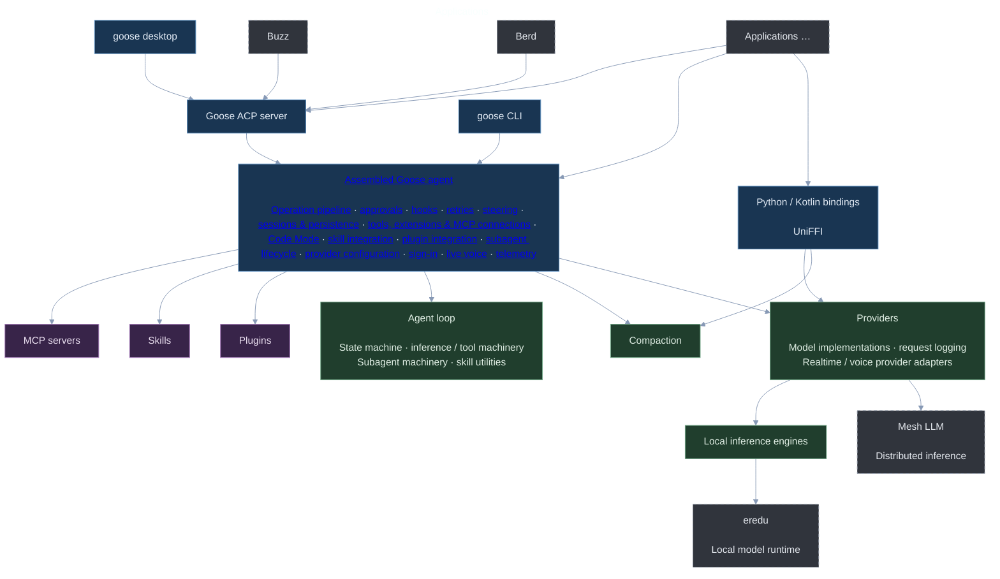

<div align="center">

# goose

_your native open source AI agent — desktop app, CLI, and API — for code, workflows, and everything in between_

<p align="center">
  <a href="https://opensource.org/licenses/Apache-2.0"
    ></a>
  <a href="https://discord.gg/n8R5VaWDAn"
    ></a>
  <a href="https://github.com/aaif-goose/goose/actions/workflows/ci.yml"
     ></a>
  <a href="https://insights.linuxfoundation.org/project/goose"></a>
  <a href="https://repology.org/project/goose-cli/versions"></a>
</p>

<a href="https://trendshift.io/repositories/25298?utm_source=repository-badge&amp;utm_medium=badge&amp;utm_campaign=badge-repository-25298" target="_blank" rel="noopener noreferrer"></a>

</div>


goose is a general-purpose AI agent that runs on your machine. Not just for code — use it for research, writing, automation, data analysis, or anything you need to get done.

A native desktop app for macOS, Linux, and Windows. A full CLI for terminal workflows. An API to embed it anywhere. Built in Rust for performance and portability.

goose works with 15+ providers — Anthropic, OpenAI, Google, Ollama, OpenRouter, Azure, Bedrock, and more. Use API keys or your existing Claude, ChatGPT, or Gemini subscriptions via [ACP](https://goose-docs.ai/docs/guides/acp-providers). Connect to 70+ extensions via the [Model Context Protocol](https://modelcontextprotocol.io/) open standard.

goose is part of the [Agentic AI Foundation (AAIF)](https://aaif.io/) at the Linux Foundation.

# Get started

**[Download the desktop app](https://goose-docs.ai/docs/getting-started/installation)** for macOS, Linux, and Windows.

Or install the CLI:

```bash
curl -fsSL https://github.com/aaif-goose/goose/releases/download/stable/download_cli.sh | bash
```

# Architecture

Arrows mean “uses.” Select a component or capability to open its source or documentation. The assembled agent lists the capabilities integrated within goose; MCP servers, skills, and plugins are extension inputs that may come from external projects.

Blue boxes are Goose interfaces and the assembled agent; green marks extracted libraries; purple marks extension inputs; gray with dashed borders marks applications and inference engines outside this repository.



# Quick links
- [Quickstart](https://goose-docs.ai/docs/quickstart)
- [Installation](https://goose-docs.ai/docs/getting-started/installation)
- [Tutorials](https://goose-docs.ai/docs/category/tutorials)
- [Documentation](https://goose-docs.ai/docs/category/getting-started)
- [Governance](https://github.com/aaif-goose/goose/blob/main/GOVERNANCE.md)
- [Custom Distributions](https://github.com/aaif-goose/goose/blob/main/CUSTOM_DISTROS.md) — build your own goose distro with preconfigured providers, extensions, and branding

## Need help?
- [Diagnostics & Reporting](https://goose-docs.ai/docs/troubleshooting/diagnostics-and-reporting)
- [Known Issues](https://goose-docs.ai/docs/troubleshooting/known-issues)

# a little goose humor 🪿

> Why did the developer choose goose as their AI agent?
> 
> Because it always helps them "migrate" their code to production! 🚀

# goose around with us
- [Discord](https://discord.gg/n8R5VaWDAn)
- [YouTube](https://www.youtube.com/@goose-oss)
- [LinkedIn](https://www.linkedin.com/company/goose-oss)
- [Twitter/X](https://x.com/goose_oss)
